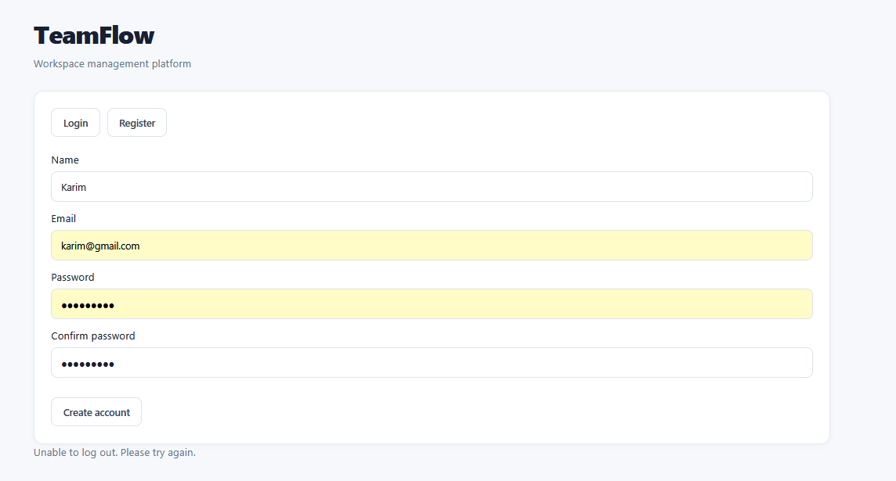
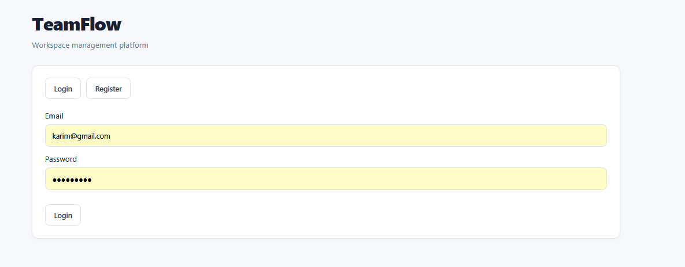
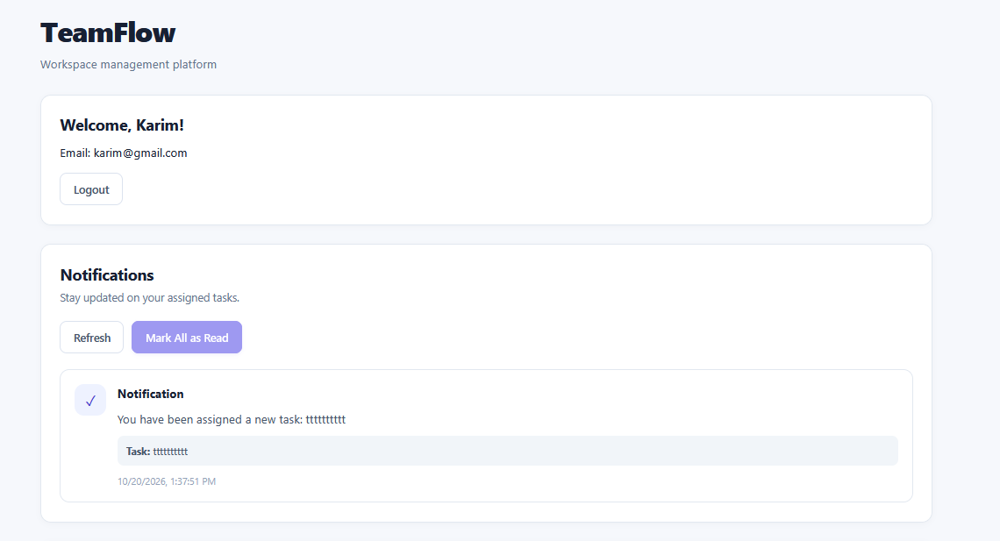
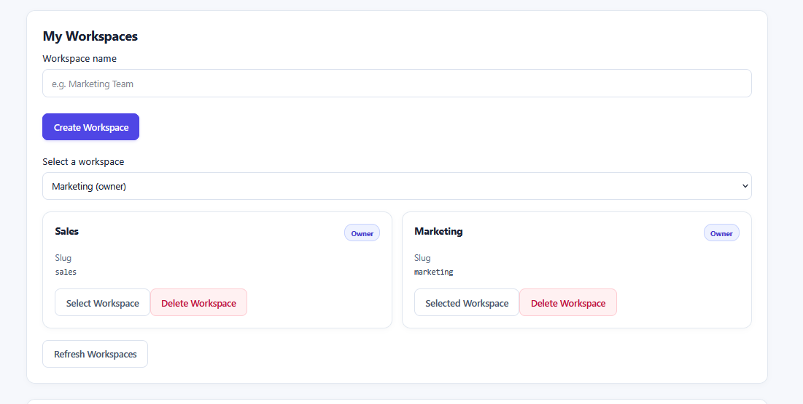
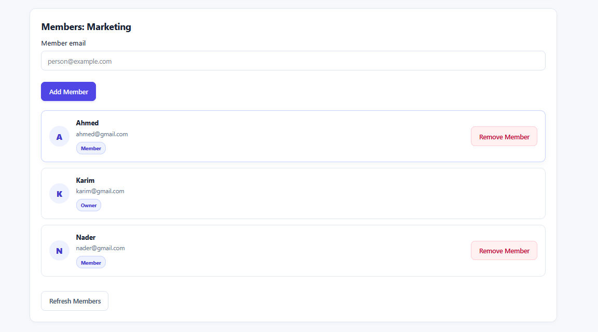
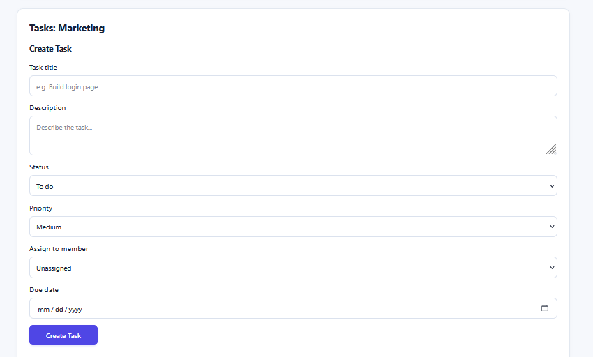
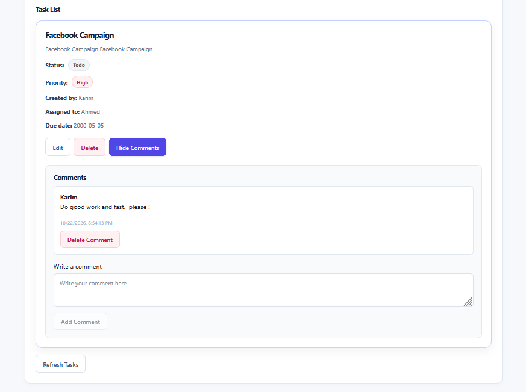
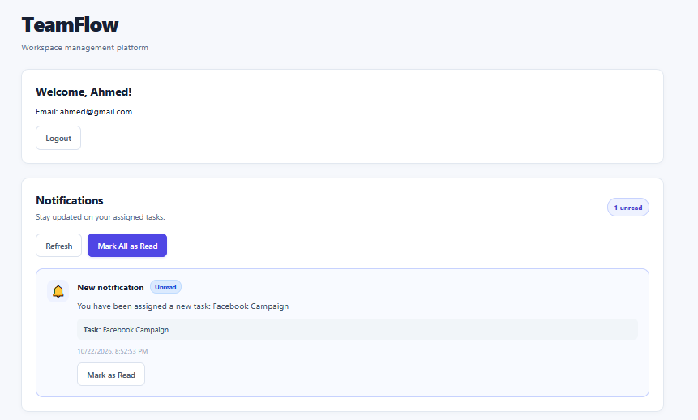

# TeamFlow Web — React Frontend

TeamFlow Web is the frontend application for **TeamFlow**, a team collaboration and task management platform.

Built with React and TypeScript, it provides an interactive interface for managing workspaces, team members, tasks, task comments, and notifications. It communicates with a Laravel REST API and uses Laravel Sanctum for session-based authentication.

## Features

### Authentication

- User registration
- User login and logout
- Persistent authenticated sessions
- Automatic restoration of the current user after refreshing the page
- CSRF protection for session-based authentication

### Workspace Management

- View available workspaces
- Create new workspaces
- Select a workspace
- Delete workspaces as an owner
- Refresh the workspace list

### Team Member Management

- View workspace members
- Add new members
- Remove members when authorized
- Display workspace member roles
- Show owner-only actions when appropriate

### Task Management

- View tasks within a workspace
- Create new tasks
- Edit existing tasks
- Delete tasks
- Set task status and priority
- Assign tasks to workspace members
- Set task due dates
- View task creators and assignees

### Task Comments

- View comments on tasks
- Add comments
- Delete comments

### Notifications

- View notifications
- Display unread notification information
- Mark individual notifications as read
- Mark all notifications as read
- Refresh the notification list

### User Experience

- Responsive layout for desktop and mobile screens
- Loading states during API requests
- Empty states when no data is available
- Error messages for failed operations
- Role-aware interface elements

## Screenshots


### Register



### Login



### Notifications


### Workspaces


### Workspace Members



### Create Task


### Tasks and Commints


### Notification of task creation



## Tech Stack

| Technology       | Purpose                                  |
| ---------------- | ---------------------------------------- |
| React            | UI development                           |
| TypeScript       | Type safety                              |
| Vite             | Development server and production builds |
| CSS              | Styling and responsive layouts           |
| Laravel Sanctum  | Session-based SPA authentication         |
| Laravel REST API | Backend communication                    |
| npm              | Package management                       |

## Related Repository

The backend API is maintained separately.

- **Backend:** Laravel REST API
- **Frontend:** React + TypeScript

Add the URL of your `teamflow-api` GitHub repository here once it is published.

## Prerequisites

Make sure you have installed:

- Node.js
- npm
- Git
- The TeamFlow Laravel backend, configured and running locally

## Getting Started

### 1. Clone the Repository

```bash
git clone https://github.com/Cooooooooooder/teamflow-web
cd teamflow-web
```

### 2. Install Dependencies

```bash
npm install
```

### 3. Configure the Backend Connection

The frontend communicates with the Laravel API.

For local development, the backend is normally available at:

```text
http://localhost:8000
```

The Vite development server normally runs at:

```text
http://localhost:5173
```

If your API client uses an environment variable for the backend URL, configure it according to your project's existing implementation.

### 4. Start the Development Server

```bash
npm run dev
```

Open the local URL displayed in your terminal, usually:

```text
http://localhost:5173
```

### 5. Build for Production

Run:

```bash
npm run build
```

This command checks the TypeScript project and generates an optimized production build in the `dist` directory.

The production build was successfully verified during development.

## Authentication and API Integration

The frontend integrates with the Laravel backend using session-based authentication with Laravel Sanctum.

The authentication flow includes:

1. Initializing the CSRF cookie.
2. Sending registration or login requests.
3. Including credentials in supported API requests.
4. Restoring the authenticated user when the application loads.
5. Sending a logout request when the user signs out.

For local development, the frontend and backend CORS and Sanctum configurations must allow the frontend origin and credentialed requests.

See the [Laravel Sanctum documentation](https://laravel.com/docs/sanctum) for details.

## Project Structure

```text
teamflow-web/
├── public/
├── screenshots/
├── src/
│   ├── lib/
│   │   └── auth.ts
│   ├── App.tsx
│   ├── App.css
│   ├── index.css
│   ├── main.tsx
│   └── types.ts
├── index.html
├── package.json
├── package-lock.json
├── tsconfig.json
└── vite.config.ts
```

The exact structure may vary as the project evolves.

## Verification

The frontend production build was successfully verified using:

```bash
npm run build
```

The command completed successfully with TypeScript checks and Vite production bundling.

Backend automated tests are maintained in the separate Laravel API repository.

## Future Improvements

Potential enhancements include:

- Kanban board interface
- Task search and filtering
- Real-time notification updates
- Improved task activity history
- Deployment to a production hosting provider

These are potential future improvements and are not claimed as implemented features.

## License

Add a license file if you intend to distribute this project under a specific open-source license.
